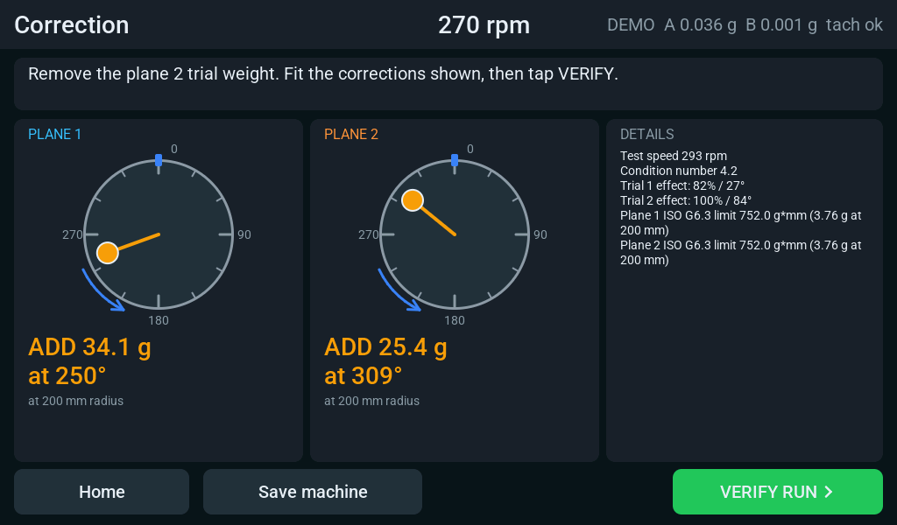
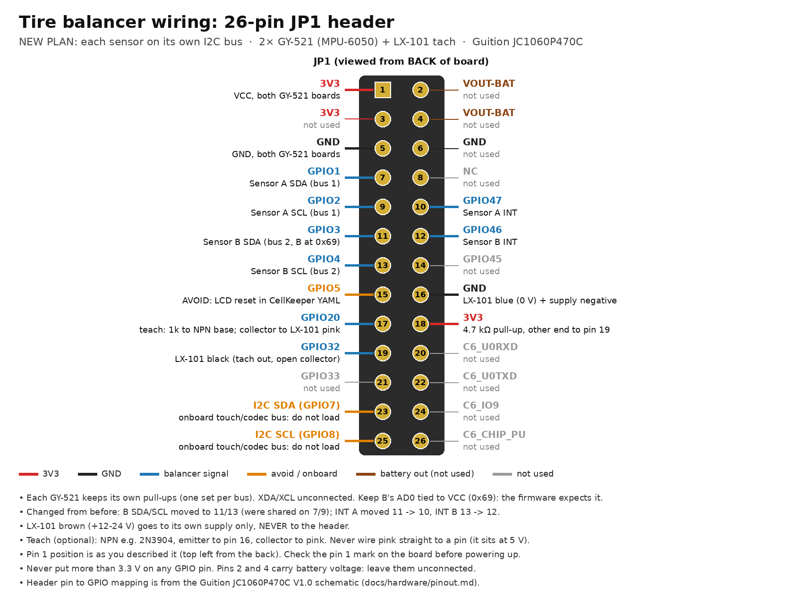

# ESP32 Wheel Balancer

Two-plane dynamic balancer for car wheels on the Guition JC1060P470C
(ESP32-P4, 7" 1024×600 touchscreen). Two GY-521 (MPU-6050) accelerometers
on I²C and an optical tach in; "add 12.4 g at 137°" out, drawn on rotor
dials on the LCD. The wheel sits on a soft leaf-spring rig and is spun by
hand.

## Status

| Phase | State |
|---|---|
| Board bring-up | display, touch and Wi-Fi run on the board |
| DSP + balancing math | done: host tests, simulator exit tests, pyPRB cross-check |
| Touchscreen UI | done: all screens, previewed on PC ([docs/ui](docs/ui)) |
| MPU-6050 acquisition | simulated end to end; both sensors read on the bench; two-bus rewire pending; not yet run on a spinning wheel |
| Persistence / export | settings, wheel setup and saved machine in flash; HA sensors |

## Hardware

> The two-bus wiring below is new (2026-11-12) and the rig has **not yet been
> validated on a spinning wheel**. Treat it as a build guide in progress.

| Part | What | Notes |
|---|---|---|
| Controller | Guition JC1060P470C_I_W_Y (ESP32-P4, 7" 1024×600 touch LCD) | powered from its USB-C port |
| Sensors | 2× GY-521 (MPU-6050) | A at 0x68 (AD0 open), B at 0x69 (AD0 to VCC); 4.7 kΩ (472) pull-ups on each board; one per bearing housing |
| Tach | Panasonic LX-101 mark sensor | own 12–24 V supply, NPN open-collector output pulled up to 3.3 V |
| Tach teach (optional) | NPN transistor (2N3904, BC547) + 1 kΩ | lets the screen's TEACH TACH button drive the LX-101's teach input |
| Case | 3D-printable rear case | build123d source and STEP in [`hardware/display_case/`](hardware/display_case/) |
| Rig | wheel spindle on a leaf spring | soft rig, sway resonance well below spin speed; spun by hand |

### Wiring (JP1, 26-pin header on the back of the board)

Each sensor has its own I²C bus, so one that hangs can't stall the other:

| JP1 pin | GPIO | Connects to |
|---|---|---|
| 1 | 3V3 | VCC, both GY-521 boards |
| 5 | GND | GND, both GY-521 boards |
| 7 / 9 | GPIO1 / GPIO2 | sensor A SDA / SCL (bus 1) |
| 10 | GPIO47 | sensor A INT |
| 11 / 13 | GPIO3 / GPIO4 | sensor B SDA / SCL (bus 2, the P4's LP I²C port) |
| 12 | GPIO46 | sensor B INT |
| 16 | GND | LX-101 blue (0 V) and its supply negative |
| 17 | GPIO20 | tach teach: 1 kΩ to the NPN base; collector to LX-101 pink |
| 18 | 3V3 | 4.7 kΩ tach pull-up, other end to pin 19 |
| 19 | GPIO32 | LX-101 black (tach output) |

- Wire INT on both boards; every reading is timestamped from it. Leave XDA and XCL open.
- LX-101 brown (+12–24 V) goes to its own supply only, **never** to the header.
  Never wire pink straight to a GPIO (it sits at 5 V); use the transistor.
- Leave pins 2 and 4 (VOUT-BAT), GPIO5 (LCD reset) and the onboard I²C pins 23/25 unconnected.
- Mount each sensor flat against a vertical face of its bearing housing. The
  firmware reads the Z axis, through the board; face both boards the same way
  (or flip "Sensor B polarity" in Settings).

All pins are set in `balancer-tire.yaml`. Full details (LX-101 teaching,
mounting, rig tuning, procedure) are in
[docs/hardware/tire-rig.md](docs/hardware/tire-rig.md); the full header and
onboard pin map is in [docs/hardware/pinout.md](docs/hardware/pinout.md).

## Flashing

GitHub Actions compiles every push. The newest binaries are attached to the
**latest** pre-release (Releases → *Latest build*):

- `balancer-tire-demo.factory.bin`: **start here.** Simulated wheel, no
  sensors needed. Walk the whole procedure on the screen: SPIN, LOCK SPEED,
  trial runs, correction, verify.
- `balancer-tire.factory.bin`: two MPU-6050 boards and the tach
  (wiring in [docs/hardware/tire-rig.md](docs/hardware/tire-rig.md)).

Flash the `.factory.bin` over USB with [ESPHome Web](https://web.esphome.io)
or `esptool.py write_flash 0x0 <file>`, then use `.ota.bin` files or
`esphome run` for updates. To build locally: copy `secrets.yaml.example` to
`secrets.yaml`, then `esphome run balancer-tire-demo.yaml`.

## How it works
- Each MPU-6050 raises INT when a reading is ready. One MCPWM capture timer
  latches those edges and the tach edges, so every reading and every tach
  pulse has a hardware timestamp.
- The two sensors run on their own clocks; each one is interpolated onto one
  uniform 250 Hz grid on the capture timer, after taking off its filter delay.
- Each revolution's orders 1×–10× come from a direct DFT against the tach
  angle. Only revolutions inside the speed window count, and coast-down
  passes add up until the 1× phase is settled.
- Influence-coefficient solver: single and two plane, trim runs, add or
  drill, fixed positions, ISO 21940-11 limit, trial-weight helper.

## Repo map
- `PLAN.md`: architecture, decisions, phases, open questions
- `balancer-tire.yaml`: device config, two MPU-6050 boards and the tach
- `balancer-tire-demo.yaml`: the same firmware with a simulated wheel
- `balancer-common.yaml`: board, network and display
- `hardware_guition_jc1060p470.yaml`: board config (from CellKeeper-BMS-LCD)
- `components/balancer/`: ESPHome component (flat layout)
  - `dsp_*` pure C++: revolution analysis, resampler, measurement, solver, job, demo wheel
  - `acq_mpu.*` MPU-6050 acquisition task: I²C reads timed by MCPWM capture
  - `ui*.{h,cpp}` touchscreen screens drawn in plain C++ (no LVGL) and the shared model; `balancer.*` ESPHome glue
- `tests/`: host tests (`cmake -S tests -B build/tests && ctest --test-dir build/tests`)
- `tools/ui_sim/`: taps through a whole job on a PC and renders every screen (`sh tools/ui_sim/run.sh`)
- `tools/crosscheck_pyprb.py`: solver cross-check against pyPRB
- `docs/hardware/`: pinout (JP1), wiring image, tire rig, schematic
- `hardware/display_case/`: 3D-printable rear case (build123d, STEP)

## License
The firmware, tools and docs in this repo are MIT licensed (see `LICENSE`).
Third-party files keep their own terms:
- `tests/third_party/doctest.h`: doctest, MIT licensed.
- `docs/hardware/schematic/JC1060P470C_I_W_Y-V1.0.pdf`: Guition's schematic
  for the JC1060P470C board, included for reference. It belongs to Guition and
  is not covered by this repo's license.
