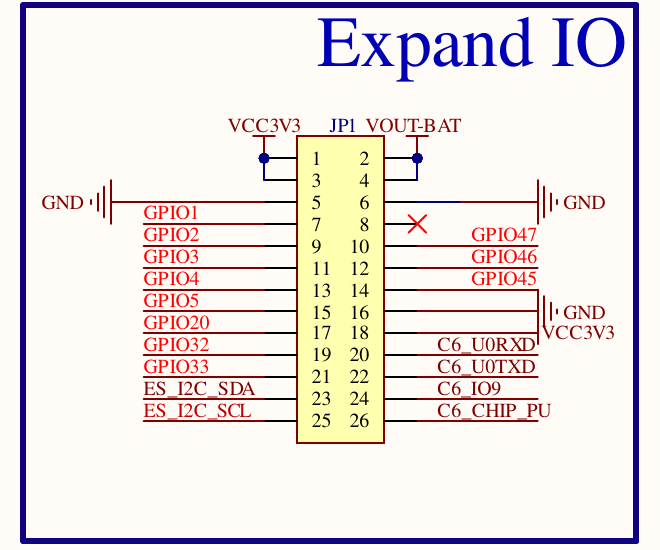

# JC1060P470C pinout (as used by esp32-wheel-balancer)

Source: `schematic/JC1060P470C_I_W_Y-V1.0.pdf` (Guition, 9/06/2025) and the
working CellKeeper-BMS-LCD ESPHome config.

## JP1 "Expand IO" header (2×13, 2.54 mm)

| Pin | Signal | Pin | Signal |
|---|---|---|---|
| 1 | 3V3: sensor boards | 2 | VOUT-BAT |
| 3 | 3V3 | 4 | VOUT-BAT |
| 5 | GND: sensor boards | 6 | GND |
| 7 | **GPIO1**: sensor SDA | 8 | NC |
| 9 | **GPIO2**: sensor SCL | 10 | GPIO47: spare |
| 11 | **GPIO3**: INT, sensor A (0x68) | 12 | GPIO46: spare |
| 13 | **GPIO4**: INT, sensor B (0x69, AD0 to VCC) | 14 | GPIO45: spare |
| 15 | GPIO5: avoid (LCD reset in CellKeeper YAML) | 16 | GND: tach sensor 0 V |
| 17 | GPIO20: spare (second sensor bus if needed) | 18 | 3V3: 4.7 kΩ tach pull-up |
| 19 | **GPIO32**: tach in (LX-101 black, open collector) | 20 | C6_U0RXD |
| 21 | GPIO33: spare (second sensor bus if needed) | 22 | C6_U0TXD |
| 23 | ES_I2C_SDA (GPIO7): onboard bus | 24 | C6_IO9 |
| 25 | ES_I2C_SCL (GPIO8): onboard bus | 26 | C6_CHIP_PU |

Pins are set in `balancer-tire.yaml`. Full wiring and rig notes are in
[tire-rig.md](tire-rig.md).

## Onboard functions (do not reuse)

| Function | GPIO |
|---|---|
| I²C bus_a (GT911, ES8311, ES7210, RTC) | 7 SDA, 8 SCL |
| GT911 INT / RST | 21 / 22 |
| Backlight PWM | 23 |
| LCD reset | 0 per schematic; CellKeeper YAML uses 5 |
| ES8311/ES7210 I2S0 | MCLK 13, SCLK 12, LRCK 10, DSDIN 9, ES7210 SDOUT 48 |
| Speaker amp enable | 11 |
| ESP32-C6 SDIO | CLK 18, CMD 19, D0–D3 14–17, RST 54 |
| USB-serial-JTAG | 24/25 |
| UART0 (CN2 MX1.25 / RS485) | 37 TX, 38 RX |
| Battery voltage | 53 |
| Boot / user button | 35 |
| Strapping pins | 34–38 |

## Things to verify on the bench
- GPIO5: free, or really driving LCD reset on this revision?
- I²C addresses vary between board batches; scan on boot.
