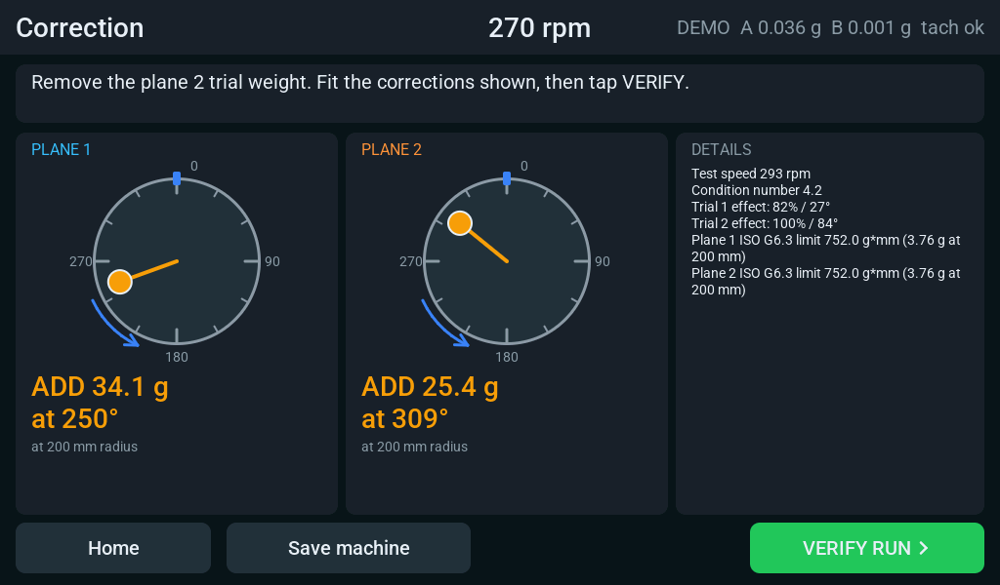

# Tire rig: MPU-6050 sensors on a leaf-spring stand

A way to balance car wheels with parts on hand: the 7" P4 board and its
touchscreen wizard, with two GY-521 (MPU-6050) accelerometer boards and a
tach. Firmware: `balancer-tire.yaml` (and `balancer-tire-demo.yaml`, a
simulated wheel for trying the procedure with nothing connected).

It works because a wheel is slow, heavy and usually well out of balance, and
because the rig is soft, so the hub moves a lot. MEMS sensors this noisy are
not a good fit for stiff stands or fast rotors.

## Wiring (JP1, the 26-pin IDC header on the back of the board)

JP1 is the 2×13 "Expand IO" header, the same one the CellKeeper HMI uses. On a
26-way ribbon cable the wire number equals the pin number, counting from the
marked edge (wire 1 = pin 1).

| JP1 pin / ribbon wire | Signal | Goes to |
|---|---|---|
| 1 or 3 | 3V3 | VCC on both GY-521 boards |
| 5 | GND | GND on both boards |
| 7 | GPIO1 | SDA on both boards |
| 9 | GPIO2 | SCL on both boards |
| 11 | GPIO3 | INT on sensor A |
| 13 | GPIO4 | INT on sensor B |
| 16 | GND | tach sensor 0 V (LX-101 blue) and the negative of its supply |
| 18 | 3V3 | top of the tach pull-up resistor |
| 19 | GPIO32 | tach signal (LX-101 black) |

Leave the other wires unconnected. Pins 2 and 4 (VOUT-BAT) and the C6 pins on
the even side are not used.

On the sensor boards:

- **INT** needs a wire on each board (the hole next to AD0). The firmware
  timestamps every reading from it.
- **AD0** on sensor B goes to its VCC pin, which moves it to address 0x69.
  Leave AD0 open on sensor A (0x68).
- XDA and XCL stay unconnected.
- The boards carry their own I2C pull-ups, so none are needed at the P4.
- Keep the sensor leads short, around a metre, and run a ground wire with
  them. If the LIVE screen's "missed readings" count climbs steadily, set
  `frequency: 100kHz` in the YAML.
- The GY-521 has a small regulator on VCC. It normally works from 3.3 V. If
  a board does not answer (the log says "nothing answers at 0x68"), feed its
  VCC from 5 V instead; SDA, SCL and INT stay at 3.3 V either way.

All pins are set in `balancer-tire.yaml` and can be moved.

For one sensor only (static, single-plane balancing), delete the `sensor_b`
block. The firmware then limits the job to one plane.

## Mounting the sensors

- Fix each board rigidly to a bearing housing: screws through the two
  mounting holes, or epoxy. Foam tape and loose zip ties add their own wobble.
- Sensor A goes on the bearing next to the wheel, sensor B on the far one.
- The firmware reads the **Z axis**, which runs straight through the board
  (underside to component side). Mount each board flat against a vertical
  face of the bearing housing, so the board faces along the motion being
  measured: horizontal, at right angles to the shaft. Face both boards the
  same way (component sides both pointing the same direction). If one has to
  face the other way, flip it under Settings, "Sensor B polarity". To use an
  in-plane axis instead, set `axis: X` or `axis: Y` in the YAML; the X and Y
  arrows are printed on the board.
- Tie the leads down a few centimetres from the board so they cannot tug on
  it.

## Tach: Panasonic LX-101 mark sensor

The index sensor is a Panasonic (SUNX) LX-101 digital mark sensor. It needs
its own 12 to 24 V supply (about 30 mA) and has NPN open-collector outputs,
so the signal wire can be pulled up to the P4's 3.3 V directly.

| LX-101 wire | Function | Connect to |
|---|---|---|
| Brown | +V | +12 to 24 V supply. **Never to the header.** |
| Blue | 0 V | supply negative **and** JP1 pin 16 (GND) |
| Black | Output 1 (NPN open collector) | JP1 pin 19 (GPIO32) |
| White | Output 2 (inverse of output 1) | not used: insulate it |
| Pink | Teaching input | not used: insulate it, teach with the buttons |

- Fit a 4.7 kΩ resistor from pin 19 to pin 18 (3V3). The firmware's internal
  pull-up is on as well, but it is weak for two metres of cable.
- The output only ever pulls to 0 V, so nothing above 3.3 V reaches the P4 as
  long as brown stays off the header.
- The sensor reads at 10 mm, give or take 3 mm, with a 1 × 5 mm spot. Aim it
  at something that runs true, such as the rim edge or the hub, not the tire
  sidewall, and give it one mark with strong contrast (white paint or tape on
  a dark surface, or the reverse). Teach it on the mark and on the background.
- `edge: FALLING` in the YAML triggers when the output switches on (pulls
  low). Whichever way the teaching ends up, there is one such edge per
  revolution, and that edge is the 0° mark for every angle the screen shows.
- Response time is 45 µs: a fixed 0.06° at 4 revolutions a second.

Any other sensor that gives one clean pulse per revolution works the same
way, as long as its output is open-collector or 3.3 V logic.

## The rig

The spindle with the wheel sits on a leaf spring (or hangs from it) so that it
can sway sideways. Two things matter:

1. **Keep the rig's resonance away from the spin speed.** Soft is best for
   these sensors: the sway resonance should be a third of the spin speed or
   lower. A wheel spun by hand to 240 to 300 rpm (4 to 5 revolutions a
   second) wants a rig that sways at about 1.5 Hz or slower. Longer free
   spring length makes it softer: doubling the length divides the resonance
   by nearly three.
2. **Check it with a tap test.** With the wheel on, tap the hub sideways and
   count the swings for ten seconds. Then tap it so the spindle twists
   (one bearing forward, the other back) and count again. Both counts should
   be below a third of the spin speed. Never run with the spin speed close to
   either one: phase then swings with every small change in speed.

On a soft rig the hub's movement barely depends on speed, so readings stay
consistent while the wheel coasts down. That is why the firmware measures
in micrometres and accepts a wide speed window.

A 20 kg wheel at a few hundred rpm stores real energy. Keep speeds low, make
sure the wheel cannot leave the spindle, and stand out of its plane.

## Procedure

1. **Setup.** Check the wheel mass, and set the trial and correction radius
   to where your weights sit on the rim (the default is 200 mm, about a
   16" rim). Plane 1 is the inner rim edge, plane 2 the outer.
2. **Run 0.** START, spin the wheel, tap LOCK SPEED at the speed you want to
   measure at (around 240 rpm), then spin it faster than that and let it
   coast. Revolutions count while the speed is inside the window. Spin again
   if needed until the screen says ready, then ACCEPT.
3. **Trial runs.** Fit the trial weight where the screen says (30 g at 0° on
   plane 1), spin and coast, ACCEPT. Move it to plane 2, repeat.
4. **Correction.** The screen shows grams and angle for each rim edge. Angles
   run from the tach mark against the direction of rotation unless changed in
   Setup.
5. **Verify.** Fit the weights, VERIFY RUN, spin and coast. The result shows
   what is left against the limit, and a trim if you want to go further.

"Enough revolutions: ACCEPT, or keep going" appears when the reading is too
small for its phase to settle, which is normal on a wheel that is already
close to balanced.

## Starting values

Set in `ModelCore::load_defaults()` (`ui_core.cpp`).

| Setting | Default | Why |
|---|---|---|
| Rotor mass, service speed, grade | 20 kg, 800 rpm, G6.3 | 3.8 g per rim edge at 200 mm; shops aim for 5 g |
| Trial weight | 30 g at 200 mm | moves the reading clearly without being silly |
| Correction | add weight | stick-on or clip-on weights |
| Units | µm | steady through a coast-down on a soft rig |
| Speed window | ±10% | only a handful of revolutions fit in ±3% at 4 rev/s |
| Speed change per revolution | 3% | a coasting wheel slows about 1% per revolution |
| Revolutions per run | 20, and ready regardless after 80 | bounded effort with noisy sensors |

Everything except the speed-change limit can be changed on the screen. That
one is `max_speed_change:` in the YAML.

## How the timing works

Each MPU-6050 runs on its own oscillator, so the two never sample together
and neither is locked to the P4. The firmware therefore:

- latches every data-ready edge (INT) and every tach edge with one 80 MHz
  MCPWM capture timer;
- reads the sensor right after each edge, and throws the reading away if a
  newer edge arrived before the read finished;
- interpolates each sensor onto a uniform 250 Hz grid defined by the capture
  timer (`dsp_resample`), where a tach edge's position is a plain division;
- stamps each reading earlier by its sensor filter's delay (4.9 ms at 44 Hz),
  so the phase is right even if the two boards carry different chips.

A reading or two lost in a row is bridged; a longer hole restarts the grid. A
sensor that goes silent (loose plug, brown-out) is set up again automatically
after a couple of seconds.

From there the per-revolution analysis, speed window and solver take over.
The LIVE screen shows the sensor's measured rate, restarts
of the grid and missed readings.

Limits of this path: all ten orders are valid up to about 670 rpm at 250
readings per second (orders above that read zero), and 1× is usable to about
1800 rpm. Chips in the MPU-6500/9250 family are detected and configured too,
but only the MPU-6050 has been the design target.
