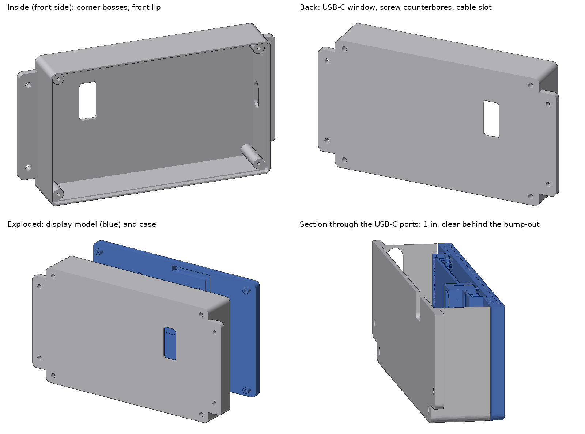

# Display rear case (build123d)

3D-printable rear case for the Guition JC1060P470C_I_W_Y 7" display. It screws
onto the display's four corner standoffs, its outline matches the glass
(181.80 x 113.72 mm, same corner radius), and it leaves 1 in. (25.4 mm) of
free depth behind the raised back cover for the sensor and tach wiring.



| File | What |
|---|---|
| `display_case.py` | The model. All dimensions are dataclass fields at the top. |
| `display_case.step` | Default build: flush outline, 1 in. clearance, front lip, side tabs. |
| `jc1060p470c_display.step` | 3D model of the display converted from the vendor DWG (outside parts only, 14 MB), placed in the case's coordinates. |
| `render_preview.py` | Writes `preview.png` (numpy z-buffer renderer, no OpenGL). |
| `JC1060P470C_I_W_Y-structure-drawing.pdf` | Vendor structure drawing the dimensions come from. |

```
pip install build123d
python display_case.py                      # flush with the glass (default)
python display_case.py --overhang 6.35      # 1/4 in. bigger all round; lip then wraps the glass edge
python display_case.py --clearance 30       # more room behind the bump-out
python display_case.py --no-lip --no-tabs
python display_case.py --stl                # also write an STL
python render_preview.py
```

## What the case has

- Overall 211.80 x 113.72 x 35.4 mm with the default settings (181.80 wide
  without the tabs): 31.2 mm behind the standoff plane plus a 4.2 mm lip
  forward of it. Display plus case is about 44 mm deep.
- Four corner bosses at 166.00 x 99.00 mm, tied into the corner walls. A 2.4 mm
  M2 through hole with a 4.6 mm counterbore from the back, leaving a 4 mm
  floor. An M2 x 8 screw from the back then has about 4 mm in the standoff. A
  long screwdriver reaches down the counterbore.
- Front lip, 1.6 mm thick, that carries the wall forward from the standoff
  tops to 0.8 mm short of the back face of the plastic bezel, so the edge gap
  is closed. With `--overhang` of 2 mm or more the lip instead wraps the bezel
  and ends flush with the glass front.
- Mounting tabs on the left and right: 5 mm thick, 15 mm out from the wall,
  91 mm long (80% of the case height), flush with the back face, each with
  two 4.5 mm holes (M4 / #8) 71 mm apart.
- USB-C window (16.8 x 35.1 mm) in the back wall over the two USB-C ports, so
  a cable plugs straight in for flashing. The ports point out of the back, and
  a normal plug's overmold ends inside the case, so the cable leaves through
  the window.
- 22 x 10 mm cable slot in the side wall next to the JP1 header (the left side
  when you look at the back) for the sensor and tach harness.
- Print back-wall down. No supports. 2.4 mm walls; PETG or PLA is fine.

Coordinates in the script are as seen from the back of the display: +X right,
+Y up, Z = 0 at the standoff tops, +Z out the back.

## Where each dimension came from

The source is Guition's structure drawing `JC1060P470C_I_W_Y-模型.pdf`
(AutoCAD, dated 2025-09-08). It ships in the vendor's download pack; the copy
used here came from the public mirror `wegi1/ESP32P4-JC1060P470C-I_W_Y`
(`3-Structure_Diagram/`, next to the same V1.0 schematic this repo has). The
pack also has a `.dwg` of the same drawing. Numbers marked *printed* are
dimension labels on the drawing. Numbers marked *scaled* were measured from the
drawing's vector geometry, scaled by the printed 181.80 mm width (the printed
heights 113.72, 99.00 and 74.67 all check out within 0.03 mm at that scale).

| Dimension | Value | Source | Confidence |
|---|---|---|---|
| Glass outline | 181.80 x 113.72 mm | printed; also on the spec sheet | good |
| Glass corner radius | 4.57 mm | scaled | check |
| Standoff spacing | 166.00 x 99.00 mm, centred | printed | good |
| Standoff OD | 5.5 mm | scaled | fine (case boss is 9 mm) |
| Standoff thread | M2 | Chester, on the unit | good |
| Glass front to back face of bezel | 7 mm measured, 8 mm in the 3D model | Chester, on the unit; vendor 3D model | good (the lip only depends on the 5 mm) |
| Standoffs past the bezel | 5 mm, OD 5, M2 hole full depth | Chester, on the unit; 3D model agrees | good |
| Back cover (bump-out) | 124.66 x 74.67 mm, R5.2, centred | printed; radius scaled | good |
| Bump-out height above standoff tops | 3.37 mm | 3D model (the 2D drawing's 8.38 is wrong) | good |
| RJ45 sticks out past the cover | 8.31 mm | 3D model | clears easily |
| USB-C pair | x 45.5..50.2, y 1.6..23.3 mm (from the back) | 3D model, matches the drawing | good |
| JP1 header | x -58.5..-52.4, y -17.3..16.8 mm (from the back) | 3D model | good |

Left/right: the 2D drawing's "bottom view" is mirrored compared with the real
back of the board. The 3D model, the spec sheet's back render and the
bare-board photo all put the USB-C ports on the right and JP1 on the left
when you look at the back, so the case follows those.

## Measure before printing

1. How deep the standoff threads go. M2 x 8 puts about 4 mm in the standoff;
   use M2 x 6 if the hole is shallower.
2. Optional: hold a ruler over the back to confirm the USB-C ports line up
   with the window (16.8 x 35.1 mm, right of centre seen from the back).

## 3D model of the display

No STEP of this display is published anywhere, but the vendor pack's
`JC1060P470C_I_W_Y.dwg` holds the full assembly as ACIS solids. It was
converted without commercial CAD: LibreDWG (patched to dump the DWG's AcDs
data section) extracts the ACIS SAB blobs, a small SAB reader rebuilds every
face in OpenCascade (planes, cylinders, cones, spheres, tori, B-spline
surfaces and curves), and the block tree places the 1,205 part instances. All
18,208 faces built; 401 of 403 unique solids are valid; the result matches the
spec sheet's back render.

- `jc1060p470c_display.step` here is the outside of the board only (glass,
  bezel, standoffs, back cover, connectors), already in case coordinates, so
  it can be imported next to `display_case.step` as is.
- The full model (every component, 102 MB) is too big for the repo; it is in
  the project files as `display_full.step.gz`.

A fit check intersects every part of the full model with the case: no contact
for the flush case or with `--overhang 6.35`. `build_display_dummy()` is still
in the script as a simple envelope; `render_preview.py` uses the real model
when the STEP is present.
